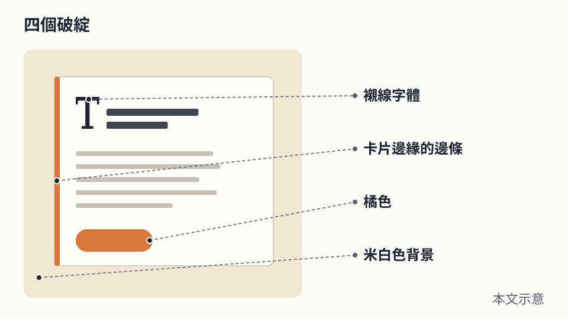
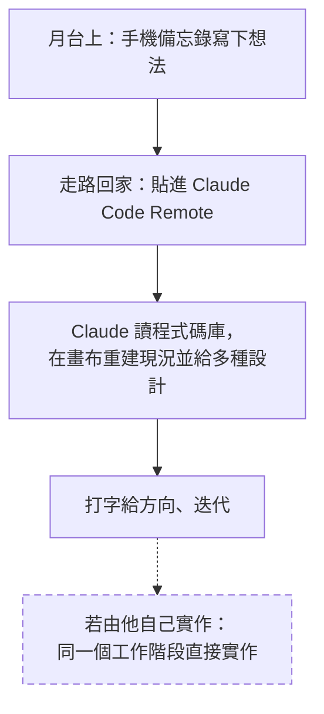
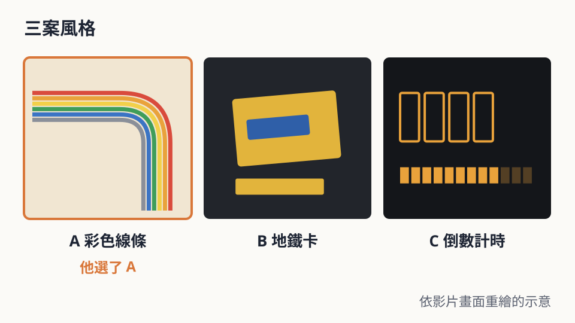

# Claude 做的設計為什麼都長一個樣：Nate Parrott 談怎麼擺脫 AI slop

*圖：本文製作的抽象示意圖：一整片預設風格、長得差不多的卡片，和放進上下文與品味之後長出不同樣貌的一張；不是影片畫面。*

> 本導讀的分析與撰稿由 AI 模型完成，不是人類分析，也沒有經過人工逐句校稿，見〈製作說明〉。

引言的中文是 AI 依 YouTube 機器字幕翻譯的譯文，可能有誤；每句直接引言附影片時間戳，可以點開對照原音。全文中譯見[全文譯本](translation-zh.html)，中英對照可用[字幕同步播放器](player.html)。

Nate Parrott 替 Claude 配過一段內心戲。你請它做一個 App，它在全新的上下文裡用力思考，心想：「天啊，使用者要我做一個 App。」（[19:22](https://www.youtube.com/watch?v=604T-74s3KE&t=1162s)）「我要發明出最出色的視覺風格。」（[19:25](https://www.youtube.com/watch?v=604T-74s3KE&t=1165s)）接著畫面上出現襯線字體、米白色背景、橘色，卡片邊緣再加一條邊條。Nate 說，問題在於「在 Claude 的腦海中，它只做過這一次」（[19:34](https://www.youtube.com/watch?v=604T-74s3KE&t=1174s)），「所以它覺得這完全是原創的。」（[19:40](https://www.youtube.com/watch?v=604T-74s3KE&t=1180s)）

常請 Claude 做簡報或網頁的人，可能認得這一套。節目章名把這四樣東西叫作「四個破綻」：設計一出來，就看得出是 AI 做的。整集的英文標題也直接點名 AI slop（AI 濫產內容）。

*圖：本文示意，把一張預設風格的卡片單獨拿出來，標出講者在 19:25–19:34 描述的四樣東西；不是講者展示的畫面。*

這集談的 Claude Design，是 Anthropic Labs 在 2026 年 4 月 17 日推出、給視覺類工作用的產品（[發布公告](https://www.anthropic.com/news/claude-design-anthropic-labs)、[Cowork is now Claude](https://claude.com/resources/articles/cowork-is-now-claude)）。

Nate 是 Anthropic 的產品設計師，2020 年加入 The Browser Company 擔任創始設計師，參與做出 Arc 瀏覽器（[本人網站](https://nateparrott.com/arc/index.html)）。依他在 Anthropic 部落格的自述，Claude Design 起初是他的副業與內部原型，團隊試用之後決定投入人力（[Anthropic 部落格，2026-07-24](https://claude.com/blog/how-the-product-designer-who-built-claude-design-uses-it-to-explore-ideas-before-building-them)）。主持人 Peter Yang 帶過十多年產品與團隊，經營 Behind the Craft 電子報與 podcast。

這集掛著教學的名字，談的範圍比教學寬，大半是一位設計師怎麼跟模型分工。Nate 從怎麼餵上下文講起，示範 Duet（Anthropic 的個人 agent）一個沒有上線的功能怎麼從手機筆記變成設計稿，再談 Anthropic 內部怎麼做原型、怎麼測一個連模型都判斷不了好壞的 skill。貫穿全場的有兩個問題：**模型的預設風格從哪裡來，人要放進什麼才能蓋過它；以及當做原型從幾週縮到一兩天，剩下慢的是哪一段。**

## 四個破綻從哪裡來

節目中段，Peter 問：Claude 以前愛在設計上加小側邊欄，這類慣性要怎麼回饋給研究人員改掉？Nate 說他們給了很多回饋，「研究團隊正積極探討如何避免這些狀況」（[19:10](https://www.youtube.com/watch?v=604T-74s3KE&t=1150s)）。開頭那段內心戲，就是他接著給的解釋：**模型每次都在全新的上下文裡創作，它不記得自己上一次、上上次也做了同一套。**

產品端能做的，是把這件事告訴模型。Nate 說，他們在 prompt 上發現很有價值的一招，**「就是直接告訴 Claude 它的失敗模式有哪些」（[19:42](https://www.youtube.com/watch?v=604T-74s3KE&t=1182s)）**。他描述 Claude Design 的提示詞會寫明：這個模型往往偏好某兩種字體、某兩種顏色，除非使用者要求或真的切題，否則別用（提示詞沒有公開，這是他的描述）。他說這招常常很有效，理由很直接：「模型根本不知道自己有哪些偏見。」（[20:04](https://www.youtube.com/watch?v=604T-74s3KE&t=1204s)）

Peter 說他自己也有一份去除設計 slop 的 prompt（[20:08](https://www.youtube.com/watch?v=604T-74s3KE&t=1208s)），但他想知道模型本身能不能學會察覺這些。Nate 說這是個懸而未決的問題，研究端在做什麼他不能透露，只能說大家確實知道、也在處理（[20:20](https://www.youtube.com/watch?v=604T-74s3KE&t=1220s)）。

他倒是丟出一個更根本的兩難：「Claude 應該嘗試從頭發明一套設計語言，還是應該堅持一套適用於所有場景的保守風格？」（[20:36](https://www.youtube.com/watch?v=604T-74s3KE&t=1236s)）他說他們其實不太確定（[20:44](https://www.youtube.com/watch?v=604T-74s3KE&t=1244s)），但希望善用 AI 做設計的人可以讓這個問題變得無關緊要：跟 Claude 一起發展出適合自家產品或品牌的風格識別，或直接帶入既有的品牌規範，模型在「毫無素材可依循」時會怎麼表現，也就不必擔心了（[20:50](https://www.youtube.com/watch?v=604T-74s3KE&t=1250s)）。

Peter 的總結把這個想法說得更白：「你的個人背景資訊和品牌脈絡，就是你能帶給新模型等工具的持久資產。」（[21:08](https://www.youtube.com/watch?v=604T-74s3KE&t=1268s)）

> 重點：四個破綻，是模型手上什麼都沒有時的樣子；Nate 在節目開頭講的那幾個做法，都是在給它東西。

## 你投入什麼，就會得到什麼

Peter 一開場就問 Nate 怎麼從 Claude 拿到最好的設計。Nate 的口頭禪是**「你投入什麼，就會得到什麼」**（"you get out what you put in"，[01:13](https://www.youtube.com/watch?v=604T-74s3KE&t=73s)）。

從零開始的新設計，他會先給一大包脈絡：截圖、像情緒板那樣的參考、他覺得有意思的其他頁面、自己過去覺得不錯的作品（[01:24](https://www.youtube.com/watch?v=604T-74s3KE&t=84s)）。接著要 Claude「盡量發散」（[01:36](https://www.youtube.com/watch?v=604T-74s3KE&t=96s)），一次給十個左右字型、顏色、視覺風格各不相同的選項。看完之後，他常說的是：「這些都不是很對，但我喜歡第一個選項的一點點，也喜歡第三個選項的一點點」（[01:54](https://www.youtube.com/watch?v=604T-74s3KE&t=114s)），再請它以這幾個為基礎多給五個，往下收斂。他在部落格上把這招寫成一句話：**先要十個選項，再混搭**（[Anthropic 部落格](https://claude.com/blog/how-the-product-designer-who-built-claude-design-uses-it-to-explore-ideas-before-building-them)）。

他大部分的工作其實是改既有產品。這時他讓 Claude 讀程式碼庫，請它「直接讀取程式碼庫，藉由讀取程式碼，將它重現為 Claude Design」（[02:18](https://www.youtube.com/watch?v=604T-74s3KE&t=138s)），在畫布上先把現有介面重建出來，再從那裡發想變化。以前用傳統設計工具，他得花很多時間截圖、在工具裡重畫一遍，「因為程式碼才是唯一事實來源」（[02:46](https://www.youtube.com/watch?v=604T-74s3KE&t=166s)）；現在這件事交給 Claude。他說 Claude 有一陣子做得很差，現在相當不錯，他預估再幾代模型，就能把任何環境、任何語言的程式碼像素級重建到畫布上（[03:02](https://www.youtube.com/watch?v=604T-74s3KE&t=182s)）。

同一個邏輯也回答了 Peter 後來的問題：程式碼一直在改，畫布要怎麼跟上？Nate 的做法是不跟。「所以我不會保留那些長期維護的檔案。」（[17:25](https://www.youtube.com/watch?v=604T-74s3KE&t=1045s)）要設計新東西時，就叫 Claude 讀相關的程式碼、在畫布上重建，再從那裡開始。

遇到特別難的設計，他會先要線框稿，因為他不希望 Claude「迷失在我要用什麼字型和顏色的視覺細節裡」（[03:29](https://www.youtube.com/watch?v=604T-74s3KE&t=209s)）。他有時也會請 Claude 去想同一類產品現有的介面怎麼排版：好的設計師會先問要解決的問題是什麼、有哪些大家已經熟悉的介面可以當捷徑（[03:49](https://www.youtube.com/watch?v=604T-74s3KE&t=229s)）；做收件匣，就先想想別人的收件匣，挑一個合適的結構畫線框（[04:04](https://www.youtube.com/watch?v=604T-74s3KE&t=244s)）。

Peter 分享了自己的經驗：Claude 做的第一版投影片太像企業公版，他就說「把它們做得更像一部電影，而不是一張投影片」（[04:29](https://www.youtube.com/watch?v=604T-74s3KE&t=269s)），結果好很多。Nate 補了一個省錢的順序：大份簡報先跟 Claude 說要先探索視覺，再做整份（[04:33](https://www.youtube.com/watch?v=604T-74s3KE&t=273s)）；整份做完才發現風格不對，重做一次就得把那些 token 再花一遍（[04:41](https://www.youtube.com/watch?v=604T-74s3KE&t=281s)）。

Nate 講到的做法整理如下：

| 情境 | 做法 | 他給的理由 |
|---|---|---|
| 從零開始 | 給截圖、參考頁面、過去作品等大量脈絡 | 你投入什麼就得到什麼（[01:13](https://www.youtube.com/watch?v=604T-74s3KE&t=73s)） |
| 從零開始 | 一次要十個左右的不同選項，挑喜歡的部分再要五個 | 擺脫 Claude 做什麼都差不多的感覺（[01:40](https://www.youtube.com/watch?v=604T-74s3KE&t=100s)） |
| 改既有產品 | 讓 Claude 讀程式碼，在畫布上重建現況再發想 | 程式碼才是唯一事實來源（[02:46](https://www.youtube.com/watch?v=604T-74s3KE&t=166s)） |
| 困難的設計 | 先要線框稿 | 不讓模型陷在字型與顏色裡（[03:29](https://www.youtube.com/watch?v=604T-74s3KE&t=209s)） |
| 任何介面 | 請 Claude 參考同類產品的既有版型 | 熟悉的介面是讓人一看就會用的捷徑（[03:53](https://www.youtube.com/watch?v=604T-74s3KE&t=233s)） |
| 大份簡報 | 先探索視覺風格，再做全套 | 風格錯了整份重做很耗 token（[04:41](https://www.youtube.com/watch?v=604T-74s3KE&t=281s)） |

## 從地鐵月台到設計稿

接著 Nate 分享螢幕，示範一個最後沒有做出來的 Duet 功能。他說自己沒有深度參與 Duet 這個專案，只在早期幫忙發想（[05:45](https://www.youtube.com/watch?v=604T-74s3KE&t=345s)）。構想是讓 Duet 主動提出你可以拿它做什麼；他說可能得給使用者看大約 20 個點子，才能找到一個對方真的想做或想交出去的事（[06:14](https://www.youtube.com/watch?v=604T-74s3KE&t=374s)）。他把這個功能叫作「以下是我能協助的事項」（[06:23](https://www.youtube.com/watch?v=604T-74s3KE&t=383s)）。

他下班搭地鐵時就開始動手：站在月台上，把一堆很高層次的想法和幾個範例打進 iPhone 的備忘錄（[06:32](https://www.youtube.com/watch?v=604T-74s3KE&t=392s)）；下車走回家的路上，把整則筆記貼進 Claude Code Remote（他從手機操作 Claude Code 的方式），請 Claude 讀公司的程式碼庫、照他前面說的方式先重建現況，再發想這個功能可能的樣子（[06:55](https://www.youtube.com/watch?v=604T-74s3KE&t=415s)）。被問到當時的 prompt 怎麼寫，他說大概就是整則筆記貼上去，加一句要它給一堆選項；他平常就是這樣：**「從程式碼庫重現、給我一堆選項，然後我們就繼續往下推進。」（[09:26](https://www.youtube.com/watch?v=604T-74s3KE&t=566s)）**

*圖：本文依講者在 06:32–08:58 的描述整理；最後一步是他說若由自己實作時的做法，這個功能最後沒有做出來。*

隔天早上回到桌機前，畫布左側是 Claude 重建的現況，一個帶訊息串流的每日簡報（[07:14](https://www.youtube.com/watch?v=604T-74s3KE&t=434s)）；另外是好幾種新設計，各有不同樣式（[07:29](https://www.youtube.com/watch?v=604T-74s3KE&t=449s)）。之後他大多是給高層次的回饋，自己形容「就像在後座指揮開車一樣」（[07:58](https://www.youtube.com/watch?v=604T-74s3KE&t=478s)）：卡片清單能不能更密、不要副標題、拿掉分隔線（[07:50](https://www.youtube.com/watch?v=604T-74s3KE&t=470s)）。他說有時也會直接進設計裡自己改（[08:08](https://www.youtube.com/watch?v=604T-74s3KE&t=488s)），那天因為有一部分在手機上做，大多用打字指揮（[08:17](https://www.youtube.com/watch?v=604T-74s3KE&t=497s)）。所有版本他都留在畫布上，方便給別人看探索過哪些方向（[09:47](https://www.youtube.com/watch?v=604T-74s3KE&t=587s)）。

最後他把截圖寄給團隊。他補充，如果這個功能由他自己實作，他會直接在同一個對話裡說可以開工了（[08:37](https://www.youtube.com/watch?v=604T-74s3KE&t=517s)）：同一個 Claude Code 工作階段已經接著程式碼庫，Claude 知道設計裡用了哪些 CSS、尺寸、字型與版面，直接實作，**「幾乎不會有任何轉譯上的落差」（[08:58](https://www.youtube.com/watch?v=604T-74s3KE&t=538s)）**。

## 做原型變快了，看人用不用沒有變快

Peter 以為接下來的流程是匯出設計、交給團隊做原型、大家試玩。Nate 說他印象中這個功能最後沒做成原型（[11:11](https://www.youtube.com/watch?v=604T-74s3KE&t=671s)），但整個 Duet 就是這樣做出來的：大家把點子放進產品的內部版本，向同事徵求回饋，快速迭代（[11:14](https://www.youtube.com/watch?v=604T-74s3KE&t=674s)）。做了某個功能卻沒滿足需求，就換做法；「或者我們做了這個功能，原本覺得會很酷，但根本沒人用，所以我們打算嘗試別的做法。」（[11:33](https://www.youtube.com/watch?v=604T-74s3KE&t=693s)）「依我的經驗，那是能非常快速產出好成果的最佳方式。」（[11:37](https://www.youtube.com/watch?v=604T-74s3KE&t=697s)）

當過多年 PM 的 Peter 接話：以前做設計衝刺、寫程式之前先做一大堆準備，是因為程式很貴，「但現在寫程式反而是最便宜的事。」（[12:08](https://www.youtube.com/watch?v=604T-74s3KE&t=728s)）

Nate 說他有工程背景，在 The Browser Company 做 Arc 時就是這樣工作，「只是我們以前做原型要花更長的時間，但我們實際製作的原型數量是一樣多的。」（[12:37](https://www.youtube.com/watch?v=604T-74s3KE&t=757s)）照他的說法，推出 Arc 之前大約花了一年做前期製作，每個點子要幾週才做得出來看成效（[12:41](https://www.youtube.com/watch?v=604T-74s3KE&t=761s)）；「而現在在 Anthropic，你大概一到兩天就能搞定。」（[12:50](https://www.youtube.com/watch?v=604T-74s3KE&t=770s)）

他接著說，**還沒壓縮到的，是把東西交到人手上、了解他們會不會用的那段週期**（"What you haven't compressed is the cycle of putting it in people's hands"，[12:55](https://www.youtube.com/watch?v=604T-74s3KE&t=775s)），這確實需要一點時間。Peter 說人的注意力依然稀缺，Nate 回：「沒錯，比以往任何時候都更加稀缺。」（[13:04](https://www.youtube.com/watch?v=604T-74s3KE&t=784s)）

*圖：本文依講者在 12:37–12:55 的說法畫的概念示意，長度不代表實際比例。*

## 先獨立、再併回：Claude Design 走過的路

Peter 接著問了一個比較尖銳的問題：Claude Design 一開始做成獨立的瀏覽器體驗，後來才併回主產品，為什麼要這樣繞？

Nate 先說：**「我覺得在一個獨立自足的空間裡迭代非常容易。」（[13:22](https://www.youtube.com/watch?v=604T-74s3KE&t=802s)）**這個工具起初只是他主要做給自己用的內部原型（[13:28](https://www.youtube.com/watch?v=604T-74s3KE&t=808s)），既然對自己有用，換到另一個介面也無所謂。獨立運作讓團隊掌控整個架構：想改 harness、想改呼叫模型的方式來提升設計品質，「那我們就去做，而且做起來超級超級容易，沒有任何人會阻礙我們。」（[14:05](https://www.youtube.com/watch?v=604T-74s3KE&t=845s)）他說團隊重建了對話、專案與產出物的整套基礎設施，還做出 Anthropic 內部第一個多人協作對話（[14:16](https://www.youtube.com/watch?v=604T-74s3KE&t=856s)）。好處是不必擔心踩到公司其他人的腳，也不會破壞 Claude 作為通用 agent 的核心體驗（[14:30](https://www.youtube.com/watch?v=604T-74s3KE&t=870s)）。

Peter 猜很多使用者根本不是設計師（[15:47](https://www.youtube.com/watch?v=604T-74s3KE&t=947s)），Nate 說兩種人都不少（[15:52](https://www.youtube.com/watch?v=604T-74s3KE&t=952s)）：一群人本來就做設計，把它當成更快的工具；另一群人會說「我其實根本不會用上一代的任何設計工具，但現在我會了」（[15:58](https://www.youtube.com/watch?v=604T-74s3KE&t=958s)），包括 PM、市場推廣人員，以及會做簡報、但沒興趣花功夫套公司設計系統的人（[16:07](https://www.youtube.com/watch?v=604T-74s3KE&t=967s)）。

Peter 說，Claude Design 他最喜歡的功能之一，是在接到要求後先跳出一整頁問題清單來釐清細節（[16:27](https://www.youtube.com/watch?v=604T-74s3KE&t=987s)）。Nate 說團隊原本很猶豫，因為傳統產品設計講究「不要增加摩擦」（[16:37](https://www.youtube.com/watch?v=604T-74s3KE&t=997s)）；結果發現「對大家來說問題永遠不嫌多」（[16:42](https://www.youtube.com/watch?v=604T-74s3KE&t=1002s)）。他說獨立版預設會問大約八個問題，也可以跳過；回答別人的提問，遠比一開始自己去想設計師會問什麼容易得多（[16:57](https://www.youtube.com/watch?v=604T-74s3KE&t=1017s)）。

併回去的理由，來自使用者。等其他大問題一個個解決，剩下最大的抱怨變成：為什麼這是獨立的東西（[14:47](https://www.youtube.com/watch?v=604T-74s3KE&t=887s)）？「為什麼我必須學習另一套工具？」（[14:51](https://www.youtube.com/watch?v=604T-74s3KE&t=891s)）為什麼不能在手機上用？為什麼 computer use 連接器和 Claude Design 不能在同一個對話裡（[14:58](https://www.youtube.com/watch?v=604T-74s3KE&t=898s)）？到了這一步，Nate 說團隊在獨立介面上的大範圍探索已經做完，「我們掌握了產品配方」（[15:17](https://www.youtube.com/watch?v=604T-74s3KE&t=917s)），可以投入時間把它搬進大家整天在用的主介面。

搬進一個使用者多得多的產品，工作量大很多：「你不能到處放自己的按鈕。」（[15:34](https://www.youtube.com/watch?v=604T-74s3KE&t=934s)）也不能隨意改 harness 的運作（[15:36](https://www.youtube.com/watch?v=604T-74s3KE&t=936s)）。他說 Anthropic 的一般原則是盡量不因為「必須整合」就擋下新功能，**「我們偶爾可以接受推出獨立運作的東西，但前提是如果它們受歡迎，你確實得把它們合併回來。」（[18:24](https://www.youtube.com/watch?v=604T-74s3KE&t=1104s)）**產品設計團隊對併回很高興，大家都覺得兩者本來就該是同一個東西；但他也說，「當你還得擔心並搞清楚它到底要如何融入生態系時，要從零到一推出一款產品會困難得多。」（[18:46](https://www.youtube.com/watch?v=604T-74s3KE&t=1126s)）

Peter 說他在其他產品上也看過同一種模式，問題常出在獨立出去的東西沒有真的併回，或是主介面被越塞越滿；Nate 同意（[18:00](https://www.youtube.com/watch?v=604T-74s3KE&t=1080s)）。官方的時間點是：2026-09-16 起 Design 可以在每個 Claude 對話裡使用，Claude Code 裡用 `/design` 指令，獨立網站 claude.ai/design 開放到 2026-12-14（[Dashboards and Motion](https://claude.com/blog/dashboards-and-motion)、[說明中心](https://support.claude.com/en/articles/14604416-get-started-with-claude-design)）。

## 同一個平台上的儀表板與動畫

後半場的兩段示範，都建在 Claude Artifacts 上。Nate 說 Anthropic 最近推出新版 Artifacts，新的 Claude Slides 和 Claude Design 就是以它為基礎做的（[22:50](https://www.youtube.com/watch?v=604T-74s3KE&t=1370s)），團隊的目標是讓平台強到能在上面做出自家的設計與簡報工具，任何人也都能拿來做任何東西：「這是一個通用的程式建置平台。」（[23:04](https://www.youtube.com/watch?v=604T-74s3KE&t=1384s)）

### 儀表板：一句話，再加一個來源模式

他說內部這樣做已經大概六到八個月，不太再用現成的儀表板工具，改請 Claude 從 MCP 抓資料、寫出符合需求的程式（[23:10](https://www.youtube.com/watch?v=604T-74s3KE&t=1390s)）。示範時不能用真實產品指標，他拿紐約大都會運輸署（MTA）的每日搭乘量 CSV 放進 Google 試算表，透過 MCP 連接器接給 Claude（[23:26](https://www.youtube.com/watch?v=604T-74s3KE&t=1406s)）。他沒想好要追蹤什麼，prompt 就只是：「嘿，幫我做個儀表板之類的隨便什麼都好。」（[23:46](https://www.youtube.com/watch?v=604T-74s3KE&t=1426s)）Claude 做完後提醒他數字是存檔副本、不會自己更新，可以改成即時讀取，他照做（[23:51](https://www.youtube.com/watch?v=604T-74s3KE&t=1431s)）。

他特別介紹的是來源模式：**「指向某個特定的數字，就能確切看到 Claude 是從哪裡取得這些資料的」（[24:49](https://www.youtube.com/watch?v=604T-74s3KE&t=1489s)）**，也能看 Claude 抓資料用的程式碼，懂資料科學的人可以藉此確認數字真的來自預期的地方（[25:15](https://www.youtube.com/watch?v=604T-74s3KE&t=1515s)）。Peter 說，不把要看什麼講得太死可能反而更好，說不定有驚喜；Nate 同意（[25:50](https://www.youtube.com/watch?v=604T-74s3KE&t=1550s)）。

### Claude Motion：先要分鏡，再挑風格

Peter 覺得把數據做成一段宣傳短片更酷。Nate 說跟儀表板一起推出的 Claude Motion，「老實說它只是針對大家已經在模型中發現的能力所做的一個輕量封裝」（[26:26](https://www.youtube.com/watch?v=604T-74s3KE&t=1586s)）：外面已經有人用模型做宣傳短片、資料視覺化與解說影片，團隊就加上一些 prompt 和 UI，讓更多人知道可以這樣做。

在這之前，Nate 回答過模型的動態影像能力是不是專門訓練出來的。他說從去年底就試著讓 Claude 做小影片和宣傳短片，當時「成果爛得搞笑。」（[21:42](https://www.youtube.com/watch?v=604T-74s3KE&t=1302s)）過去一年每個新模型都進步一點，從「爛得搞笑」跨到「單純很爛」（[21:55](https://www.youtube.com/watch?v=604T-74s3KE&t=1315s)），再到現在的「這還算可以」（[22:05](https://www.youtube.com/watch?v=604T-74s3KE&t=1325s)）。是否直接針對這個訓練，他說不確定，但模型通用能力變強時，常「就會順帶湧現出你根本沒真正預料到的能力，而動態正是其中之一。」（[22:25](https://www.youtube.com/watch?v=604T-74s3KE&t=1345s)）

示範的影片用的是同一份 MTA 資料，對話串很長，因為「我第一次嘗試時其實並沒有得到我想要的結果。」（[26:59](https://www.youtube.com/watch?v=604T-74s3KE&t=1619s)）他的流程跟前面做設計的方法一樣：

1. 第一個 prompt 請 Claude「使用動態 artifact 結合這個儀表板的資料來講個故事」（[27:03](https://www.youtube.com/watch?v=604T-74s3KE&t=1623s)），要它先交一份靜態草圖形式的分鏡，再做一個 artifact 展示幾種有代表性的視覺風格，另外貼上一些參考靈感（[27:10](https://www.youtube.com/watch?v=604T-74s3KE&t=1630s)）。
2. 分鏡是靜態的，**「這樣做不需要花費太多 token，但它大致向我展示了 Claude 打算鎖定的方向。」（[27:36](https://www.youtube.com/watch?v=604T-74s3KE&t=1656s)）**
3. 風格有三案：A 是彩色線條，B 是地鐵卡（MetroCard），C 是倒數計時（[27:51](https://www.youtube.com/watch?v=604T-74s3KE&t=1671s)）。他一看就說：「噢，很明顯就是 A 了。」（[27:55](https://www.youtube.com/watch?v=604T-74s3KE&t=1675s)）
4. 之後改了好幾個版本，最後的影片用線條主題呈現 2020 年以來搭乘量的變化與復甦（[28:24](https://www.youtube.com/watch?v=604T-74s3KE&t=1704s)）。

*圖：依影片 27:47–27:55 的畫面重繪的抽象示意，不含原畫面的數字與圖樣。*

他對現況的評語很保守：「動畫不算差，但也稱不上絕佳，需要反覆推敲調整才能達到令人滿意的水準。」（[28:43](https://www.youtube.com/watch?v=604T-74s3KE&t=1723s)）

他點出目前模型的一個弱點：Claude 做動畫常讓螢幕上很多東西同時變動，因為它是機器，可以同時注意好幾處（[29:02](https://www.youtube.com/watch?v=604T-74s3KE&t=1742s)），還沒內化人一次只能看清一件事（[29:17](https://www.youtube.com/watch?v=604T-74s3KE&t=1757s)）。所以他常在 prompt 裡提醒：「我們需要一些時間來消化內容。」（[29:19](https://www.youtube.com/watch?v=604T-74s3KE&t=1759s)）

> 重點：做動畫時得想清楚：文字放上螢幕後，有沒有留夠時間讓人讀完；下一個變化出現時，觀眾的視線會不會剛好在那裡（[29:25](https://www.youtube.com/watch?v=604T-74s3KE&t=1765s)）。

修改過程中，他跟 Claude 說過「這感覺就像靜態簡報投影片」，要它加點動態、用一條線串起整段（[29:40](https://www.youtube.com/watch?v=604T-74s3KE&t=1780s)）；有一次「在走去吃晚餐的路上，我開啟了語音模式」，把哪裡不對的想法一股腦說出來（[29:49](https://www.youtube.com/watch?v=604T-74s3KE&t=1789s)）。到了微調階段，他改用留言工具，在影片的特定時間點、畫布的特定位置留言（[30:21](https://www.youtube.com/watch?v=604T-74s3KE&t=1821s)），不必每次都描述「在 17 秒處的左上角，這段文字跟這段文字重疊」（[30:33](https://www.youtube.com/watch?v=604T-74s3KE&t=1833s)），留完再請 Claude 處理所有留言。他說像 Motion 這種 artifact 還能框選某個東西說「把這個變藍色」（[30:59](https://www.youtube.com/watch?v=604T-74s3KE&t=1859s)）。

## 模型判斷不了品味時，怎麼測一個 skill

Peter 問 Nate，經過這麼多迭代，有沒有把經驗做成 skill。Nate 說有一個專門做 Anthropic 內部宣傳短片的 skill（[31:26](https://www.youtube.com/watch?v=604T-74s3KE&t=1886s)），做法是把雲端硬碟裡一批官方新功能影片交給 Claude，請它「分析這些影片，觀察畫面影格，看看每個環節之間停頓了多久」，再全部寫下來（[31:41](https://www.youtube.com/watch?v=604T-74s3KE&t=1901s)）。他說這個 skill 在內部相當受歡迎，Slack 上常看到製作精良的影片，其實任何人的蠢點子都能用這種形式呈現（[31:55](https://www.youtube.com/watch?v=604T-74s3KE&t=1915s)）。「我不知道這樣是好是壞，但確實挺有趣的。」（[32:05](https://www.youtube.com/watch?v=604T-74s3KE&t=1925s)）他自己不懂 After Effects，對他來說，「這是我以前從未有過、現在卻有了的能力」（[32:22](https://www.youtube.com/watch?v=604T-74s3KE&t=1942s)）。

Peter 提出他的困擾：每次叫 Claude「根據這段對話」更新 skill，skill 就會過度配適到眼前那段對話（[32:39](https://www.youtube.com/watch?v=604T-74s3KE&t=1959s)）。Nate 的回答先坦白：skill 是請 Claude 更新的，「我實際上根本沒有讀過它。」（[32:54](https://www.youtube.com/watch?v=604T-74s3KE&t=1974s)）「也許我當初應該讀一下的。」（[32:55](https://www.youtube.com/watch?v=604T-74s3KE&t=1975s)）

他的檢查方法是一個很輕的評測。他先給 Claude 一個題目：想出 Claude.ai 裡最無聊的功能，替它們做宣傳短片（[32:56](https://www.youtube.com/watch?v=604T-74s3KE&t=1976s)）。之後每改一次 skill，就請 Claude 開幾個 Claude Code 工作階段，除了這個 skill 和一句像是替模型選擇器做宣傳短片的 prompt，什麼都不告訴它們（[33:11](https://www.youtube.com/watch?v=604T-74s3KE&t=1991s)），再看產出內容對不對（[33:19](https://www.youtube.com/watch?v=604T-74s3KE&t=1999s)）。他稱之為「臨時的評測（eval）」（[33:24](https://www.youtube.com/watch?v=604T-74s3KE&t=2004s)）。至於模型過度執著於你交代的特定細節，他認為那是判斷力的問題，很難靠 prompt 解決，會隨模型能力提升而改善（[33:27](https://www.youtube.com/watch?v=604T-74s3KE&t=2007s)）。Peter 追問有沒有評審機制，Nate 說像動態設計這種事，寫一套評測會比直接看幾個範例還費工（[33:49](https://www.youtube.com/watch?v=604T-74s3KE&t=2029s)）。

Peter 接著說，他的 skill 評測很多是是非題，因為據他理解，那比 1 到 5 分好，Claude 不太分得出 4 分和 5 分差在哪（[34:01](https://www.youtube.com/watch?v=604T-74s3KE&t=2041s)）。Nate 同意**是非題遠比 1 到 5 分的量表好**，並補充：真要用量表，就像評估員工或面試者，得說清楚 5 分長什麼樣、4 分長什麼樣、2 分缺了什麼（[34:19](https://www.youtube.com/watch?v=604T-74s3KE&t=2059s)）。他說這歸結到溝通能力，就像「如果你是人資部門的一員，正試圖設計出一套非常優秀的員工績效考核系統」（[34:35](https://www.youtube.com/watch?v=604T-74s3KE&t=2075s)）。

設計類的評測，他說非常難，問題在於**「如果你假設模型沒有頂尖的品味，那你就不能用模型來主觀評定某個東西是否具備好的設計品質」（[34:52](https://www.youtube.com/watch?v=604T-74s3KE&t=2092s)）**。能自動評的只剩基本項：文字有沒有重疊（[35:04](https://www.youtube.com/watch?v=604T-74s3KE&t=2104s)），給 10 個 prompt，產出是不是全用同一種字體和顏色（[35:10](https://www.youtube.com/watch?v=604T-74s3KE&t=2110s)）。更深一層的好不好看，靠的是人：「閱讀對話紀錄、檢視產出成果，然後持續迭代」（[35:26](https://www.youtube.com/watch?v=604T-74s3KE&t=2126s)）。

## 品味，以及打錯字的價值

Peter 問了每個設計師都在談的問題：品味是什麼，AI 會不會有一天也有好品味？

Nate 說這跟「什麼是藝術」一樣是哲學問題（[35:47](https://www.youtube.com/watch?v=604T-74s3KE&t=2147s)）。你可以主張品味是人類與生俱來的，就像可以主張藝術是人類的，因為它試圖說出關於人類處境的某些東西（[35:51](https://www.youtube.com/watch?v=604T-74s3KE&t=2151s)）。他同意今天這些 AI 工具常見的失敗模式，就是產出一看就知道是 slop（[36:02](https://www.youtube.com/watch?v=604T-74s3KE&t=2162s)），但他認為這大概會減少（[36:11](https://www.youtube.com/watch?v=604T-74s3KE&t=2171s)），「模型在產出更多樣化的輸出上會變得更好。」（[36:13](https://www.youtube.com/watch?v=604T-74s3KE&t=2173s)）他舉紐約街頭為例：到處都是用 ChatGPT 生成的貝果熟食店廣告，「同樣的字體、完全相同的版面配置、同樣瘋狂的那些套路。」（[36:24](https://www.youtube.com/watch?v=604T-74s3KE&t=2184s)）

他也覺得有些東西是人獨有的：當一個人真的有話想說、真的為某件事自豪，那種東西總會透出來；只是未來談品味，大概不再只看視覺上的潤飾與精緻（[36:40](https://www.youtube.com/watch?v=604T-74s3KE&t=2200s)）。Peter 說品味會變成很個人的事，模型整體品味會變好，但你我覺得好的東西不一樣（[36:51](https://www.youtube.com/watch?v=604T-74s3KE&t=2211s)）。Nate 接著說，「而且大概會變得更加關乎真實性。」（[36:57](https://www.youtube.com/watch?v=604T-74s3KE&t=2217s)）**他現在在電子郵件裡看到錯字，「反而更看重它」（[37:05](https://www.youtube.com/watch?v=604T-74s3KE&t=2225s)），因為那像一種工作量證明：「我知道真的有人花時間把它打出來。」（[37:12](https://www.youtube.com/watch?v=604T-74s3KE&t=2232s)）**他相信動畫和設計也會找到視覺上的對應物（[37:14](https://www.youtube.com/watch?v=604T-74s3KE&t=2234s)）。

## 一條對話跑一個月，Claude Tag 當成一個人

最後 Peter 問 Nate 平常怎麼跟 Claude 工作。工程師會用一個協調者同時調度上百個對話串，設計師呢？他用 Duet 還是一般的 Claude？

Nate 說他用一般的 Claude，因為它能存取程式碼庫，而他很多設計都在程式碼庫裡做（[37:47](https://www.youtube.com/watch?v=604T-74s3KE&t=2267s)）；對 Duet，他的期待是「我希望我們的整個產品在某個時間點都能像那樣運作」（[37:53](https://www.youtube.com/watch?v=604T-74s3KE&t=2273s)）。

最大的設計專案，他通常只在 Claude Code 開一條對話，信任它自己啟動 sub-agent 處理各項任務（[37:58](https://www.youtube.com/watch?v=604T-74s3KE&t=2278s)）。重新設計 Claude Design 時，他在那一條對話裡累積了大約 36 個 artifact，他說「那其實不算太理想」（[38:14](https://www.youtube.com/watch?v=604T-74s3KE&t=2294s)），但好處是全部共享上下文，他不必擔心它們知不知道自己在做什麼（[38:19](https://www.youtube.com/watch?v=604T-74s3KE&t=2299s)）。他發現 Claude 已經很會處理很長的對話串，會自己管理記憶、上下文和 sub-agent（[38:31](https://www.youtube.com/watch?v=604T-74s3KE&t=2311s)）。**「所以我通常要嘛為單次任務開一個極小的對話串，要嘛為整整一個月開一個超長對話串。」（[38:37](https://www.youtube.com/watch?v=604T-74s3KE&t=2317s)）**Peter 說他也是這樣，把每條對話串當成一份獨立的工作，同時管超過五條左右大概就應付不來了（[38:45](https://www.youtube.com/watch?v=604T-74s3KE&t=2325s)）。

另一個他天天用的是 Claude Tag，也就是在 Slack 裡標記 Claude 的功能（[說明文件](https://www.claude.com/docs/claude-tag/concepts/how-it-works)）。Nate 說 Anthropic 內部大量使用（[38:55](https://www.youtube.com/watch?v=604T-74s3KE&t=2335s)），好處是「它就在你本來就會去查看的同一個空間裡」（[39:03](https://www.youtube.com/watch?v=604T-74s3KE&t=2343s)）。**「而且我就把 Claude Tag 當作一個人。」（[39:13](https://www.youtube.com/watch?v=604T-74s3KE&t=2353s)）**他不把它當成一堆對話串，也完全不擔心上下文，預設它記得跟他、跟公司裡每個人的互動（[39:20](https://www.youtube.com/watch?v=604T-74s3KE&t=2360s)）。他隨即補了一句：**「顯然它實際上並沒有那麼誇張」**，但已經接近到可以直接問「你記得我們上週做的那個東西嗎」（[39:26](https://www.youtube.com/watch?v=604T-74s3KE&t=2366s)）。Peter 說，Claude Tag 大概是目前多人加多個 agent 協作最好的體驗（[39:37](https://www.youtube.com/watch?v=604T-74s3KE&t=2377s)）。

## 從 Arc 到「Arc 風格側邊欄」

節目尾聲，Peter 提到 Arc 即將停止維護（依 TechCrunch 報導，停止日是 2026-12-22，使用者被引導改用 Dia；[TechCrunch，2026-10-22](https://techcrunch.com/2026/10/22/arc-browser-sunsets-december-22-as-the-browser-company-doubles-down-on-dia/)），問曾是創始設計師的 Nate 有什麼感受。Nate 說 The Browser Company 留下的，一是 Dia 相當不錯，二是**「我認為我們掀起了這波瀏覽器創新的浪潮。」（[40:06](https://www.youtube.com/watch?v=604T-74s3KE&t=2406s)）**公司剛成立時，他常拿 2008 年 Chrome 剛推出時的截圖給人看，問跟現在的 Chrome 有什麼不同，答案幾乎是只有顏色（[40:10](https://www.youtube.com/watch?v=604T-74s3KE&t=2410s)）；現在的 Chrome 跟幾年前已經大不相同。他說不會把功勞都算在 The Browser Company 身上，但很高興現在有這麼多人在做自己的瀏覽器（[40:30](https://www.youtube.com/watch?v=604T-74s3KE&t=2430s)）。

他還說了一個小插曲：偶爾請 Claude 設計東西，它會說**「噢，這是一個 Arc 風格的側邊欄」（[40:58](https://www.youtube.com/watch?v=604T-74s3KE&t=2458s)）**，讓他覺得很神奇。

Peter 接著抱怨 Claude 老是說某件事要兩天，結果五分鐘就做完。Nate 說他也遇過，Claude 說要做六週，他心想：「雖然很不想打擊你，Claude，但我們接下來 20 分鐘就要一起把這個做完」（[41:17](https://www.youtube.com/watch?v=604T-74s3KE&t=2477s)）。他不知道原因，「大概是模型的某種怪癖」（[41:27](https://www.youtube.com/watch?v=604T-74s3KE&t=2487s)）。

## 對照官方：方案限制與講者說法

以下資料截至 2026-11-22。**節目裡沒有提這幾個功能的方案限制**，官方寫的開放範圍如下：

| 功能 | 節目中出現處 | 官方寫的開放範圍 | 來源 |
|---|---|---|---|
| Claude Motion | Nate 示範（[26:26](https://www.youtube.com/watch?v=604T-74s3KE&t=1586s)） | Team、Enterprise 方案的 beta | [Dashboards and Motion](https://claude.com/blog/dashboards-and-motion)、[Artifacts 功能頁](https://claude.com/features/artifacts) |
| 儀表板／Claude Data | Nate 示範（[23:07](https://www.youtube.com/watch?v=604T-74s3KE&t=1387s)） | 錄影時是付費方案的 beta；現行 Artifacts 頁以 Claude Data 涵蓋儀表板，寫明付費方案可用、2026-11-20 起預設開啟 | [Dashboards and Motion](https://claude.com/blog/dashboards-and-motion)、[Artifacts 功能頁](https://claude.com/features/artifacts) |
| Claude Tag | Nate 談內部用法（[38:55](https://www.youtube.com/watch?v=604T-74s3KE&t=2335s)） | Team、Enterprise 的 beta（2026-06-23 公告） | [Introducing Claude Tag](https://www.anthropic.com/news/introducing-claude-tag) |
| Duet | Nate 示範早期構想（[05:45](https://www.youtube.com/watch?v=604T-74s3KE&t=345s)） | research preview，先開放美國的 Pro、Max、Ultra 訂閱者，採候補名單 | [Claude Duet](https://claude.com/blog/claude-duet) |

Nate 是 Anthropic 員工，談的是自家產品和內部做法。**一到兩天做出原型、內部六到八個月不太用現成儀表板工具、Anthropic 內部第一個多人協作對話、他把 Claude Tag 當成一個人的用法，都只有他的說法。**Duet 的示範接的是 Anthropic 自家的程式碼庫，儀表板與動畫用的是放進 Google 試算表的 MTA 公開資料，代替真實產品指標；設計稿、儀表板與動畫的畫面細節以影片為準。

## 重點結論與實際啟示

Nate 的工作流程有個共同節奏：**先用便宜的產出換方向，再把力氣花在選定的方向上。**前面那十個左右的選項、線框稿、靜態分鏡和三案風格，都是這樣用的；簡報那段重花 token 的例子，說的是順序反過來的代價。

## 製作說明：這篇導讀由 AI 模型完成

本導讀的分析與撰稿由 AI 模型完成，不是人類分析，也沒有經過人工逐句校稿。分工如下：逐句中文翻譯由 agy 的 gemini-3.8-flash-medium 完成，再由 Claude Opus 5.5 讀完全部 581 句中英對照、修正其中 35 句（含下文依聽音結果修正的 9 句）；存疑句的聽音校對用 agy 的 gemini-3.8-flash-high；研究與撰稿由 Claude Opus 5.5 完成；獨立審稿三路，事實審稿用 Claude Opus 5.5，並另做第二方查證，14 條已確認的主張都回官方原頁核對，編輯審稿用 Claude Sonnet，修稿後的終審用 Claude Opus 5.5。之後由 Claude Opus 5.5 依總編輯準則潤稿並標示重點，其後又經兩輪總編輯審查與潤稿（共三輪，皆為 AI 模型執行）。整體流程由 Claude Sonnet 5.5 統籌派工與合併審稿意見。本文的圖由 Claude Opus 5.5 以 SVG、動態 SVG 與 Mermaid 繪製，未使用 AI 生圖：封面是抽象示意圖，四個破綻與做原型週期兩張是本文的示意，Motion 三案風格依影片畫面重繪，流程圖依講者描述整理；除 Motion 三案外，都不是影片畫面。封面以極慢速度循環漂移，做原型週期一張的動畫只播一次、停在完整畫面；系統設定開啟減少動態效果時，兩張都直接顯示靜態畫面。

字幕是 YouTube 機器字幕，沒有說話者標記，說話者依上下文判斷。約 55 句存疑句由 AI 聆聽原音片段核對，其中 9 句的中文依聆聽結果修正，與英文欄的機器字幕用字不同，這類句子本文只轉述、不當直接引言；其餘句子沒有對照原音。引言的中文是翻譯，不是講者原話，可能有誤。產品功能、方案與日期以 Anthropic 官方頁面原文為準，只有講者說法的內容標為他的說法。

完整中文譯本見[全文譯本](translation-zh.html)，中英對照可用[字幕同步播放器](player.html)。

## 來源清單

- Full Tutorial: How to Fix AI Slop with Claude Design in 40 Minutes | Nate Parrott，Peter Yang 頻道，2026-11-15 上傳（說明欄註明 2026-10-23 錄影），第一手：[https://www.youtube.com/watch?v=604T-74s3KE](https://www.youtube.com/watch?v=604T-74s3KE)
- How the product designer who built Claude Design uses it to explore ideas before building them（Nate Parrott 署名），Claude 部落格，2026-07-24，官方：[https://claude.com/blog/how-the-product-designer-who-built-claude-design-uses-it-to-explore-ideas-before-building-them](https://claude.com/blog/how-the-product-designer-who-built-claude-design-uses-it-to-explore-ideas-before-building-them)
- Claude Design 發布公告（Anthropic Labs，research preview），Anthropic，2026-04-17，官方：[https://www.anthropic.com/news/claude-design-anthropic-labs](https://www.anthropic.com/news/claude-design-anthropic-labs)
- Cowork is now Claude，Claude，2026-09-16，官方：[https://claude.com/resources/articles/cowork-is-now-claude](https://claude.com/resources/articles/cowork-is-now-claude)
- Dashboards and Motion，Claude 部落格，2026-10-08，官方：[https://claude.com/blog/dashboards-and-motion](https://claude.com/blog/dashboards-and-motion)
- Get started with Claude Design，Claude 說明中心，頁面未載日期（2026-11-22 讀取），官方：[https://support.claude.com/en/articles/14604416-get-started-with-claude-design](https://support.claude.com/en/articles/14604416-get-started-with-claude-design)
- Claude Artifacts 功能頁，Claude，頁面未載日期（2026-11-22 讀取），官方：[https://claude.com/features/artifacts](https://claude.com/features/artifacts)
- Claude Duet，Claude 部落格，2026-10-21，官方：[https://claude.com/blog/claude-duet](https://claude.com/blog/claude-duet)
- Introducing Claude Tag，Anthropic，2026-06-23，官方：[https://www.anthropic.com/news/introducing-claude-tag](https://www.anthropic.com/news/introducing-claude-tag)
- Claude Tag: How it works，Claude 說明文件，頁面未載日期（2026-11-22 讀取），官方：[https://www.claude.com/docs/claude-tag/concepts/how-it-works](https://www.claude.com/docs/claude-tag/concepts/how-it-works)
- Arc（Nate Parrott 本人網站），日期未載，第一手：[https://nateparrott.com/arc/index.html](https://nateparrott.com/arc/index.html)
- About（Peter Yang 本人頁），Creator Economy，日期未載，第一手：[https://creatoreconomy.so/about](https://creatoreconomy.so/about)
- Arc browser sunsets December 22 as The Browser Company doubles down on Dia，TechCrunch，2026-10-22，二手：[https://techcrunch.com/2026/10/22/arc-browser-sunsets-december-22-as-the-browser-company-doubles-down-on-dia/](https://techcrunch.com/2026/10/22/arc-browser-sunsets-december-22-as-the-browser-company-doubles-down-on-dia/)
